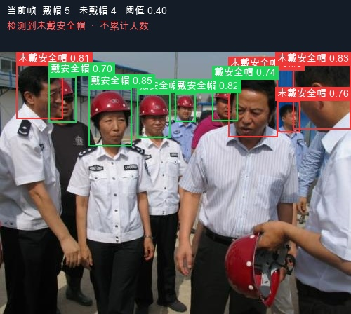

# 工地安全帽佩戴检测实验

使用 YOLO26n 检测 `helmet` 和 `no_helmet`。数据处理、正式训练、标准测试、验证集阈值选择、图片与视频监测已完成。最终阈值为 **0.40**，仅由验证集选择。已完成图片与本地视频监测验收，场景表现与优化方向详见最终报告。



## 快速开始

需要 Python 3.12 和 Git。Ultralytics 以子模块固定在实验使用的提交 `00cd4b8b187b6c7bc34776a6fe25a000f08b5fcc`。

克隆仓库并进入项目目录：

```bash
git clone --recurse-submodules https://github.com/yuantt812/helmet.git
cd helmet
```

然后执行：

```bash
# 已经普通克隆过的项目也可用此命令补齐子模块
git submodule update --init --recursive
python3.12 -m venv .venv
source .venv/bin/activate
python -m pip install -r requirements-train.txt

# 不需要下载数据集，使用仓库自带的视频和最终权重
python scripts/monitor_helmet.py \
  --source deliverables/demo_input.mp4 \
  --output outputs/demo_result.mp4
```

Windows PowerShell 使用 `.venv\Scripts\Activate.ps1` 激活环境。`requirements-train.txt` 是原实验环境的版本快照；CUDA 用户应按设备安装相应的 PyTorch 构建，原实验使用 macOS ARM64 / MPS。默认自动选择 MPS、CUDA 或 CPU，也可指定 `--device cpu`。

中文绘制需要字体：macOS 和 Windows 会查找系统字体，Ubuntu 可先安装 `fonts-noto-cjk`，其他路径使用 `--font /path/to/font.ttf`。视频输出还要求 OpenCV 支持 H.264 编码；若报 `H.264 encoder unavailable`，需更换支持该编码器的 OpenCV 构建。图片推理无需视频编码器。

原始数据、生成的数据集、预训练权重和虚拟环境不随仓库分发。推理演示所需的 **best.pt 和 demo_input.mp4 已包含**，均小于 GitHub 单文件限制，无需 Git LFS。训练或完整评价前，先按[数据恢复说明](datasets/hard-hat-workers/README.md#恢复数据与重新生成划分)准备数据。GitHub 的 ZIP 下载不包含子模块源码，推荐使用 Git 克隆。

## 项目结构

```text
config/          冻结的推理参数与权重 SHA256
scripts/         数据处理、训练、评价和图片/视频监测
datasets/        数据来源、人工审查、分组划分清单（不含完整图片与标签）
deliverables/    最终报告、验收指标、演示图片和视频
runs/            本次实验的最佳权重、指标与曲线（其余运行输出忽略）
ultralytics/     固定版本的上游子模块
docs/            GitHub 发布步骤
```

## 核心交付

| 材料 | 路径 |
| --- | --- |
| 最终实验报告 | [工地安全帽佩戴检测实验报告.docx](deliverables/工地安全帽佩戴检测实验报告.docx) |
| 原始实验方案 | [工地安全帽佩戴检测实验方案.docx](工地安全帽佩戴检测实验方案.docx) |
| 冻结推理配置 | [config/monitor.json](config/monitor.json) |
| 阈值搜索、固定阈值指标、案例及验收 | [deliverables/acceptance.json](deliverables/acceptance.json) |
| 检测图片 | [deliverables/demo_image.jpg](deliverables/demo_image.jpg) |
| 演示输入视频 | [deliverables/demo_input.mp4](deliverables/demo_input.mp4) |
| 演示输出视频 | [deliverables/demo_output.mp4](deliverables/demo_output.mp4) |
| 最佳权重 | [best.pt](runs/helmet/yolo26n_100e_b8_20261015_145934/weights/best.pt) |
| 原始标准评价 | [metrics.json](runs/evaluation/yolo26n_100e_b8_20261015_145934_test_metrics/metrics.json) |
| 数据预处理说明 | [PREPROCESSING.md](datasets/hard-hat-workers/PREPROCESSING.md) |

训练实际完成 80 轮，第 60 轮最佳，patience=20 正常提前停止。测试集 704 张，总体 mAP50=96.51%、mAP50–95=67.15%。固定演示阈值 0.40 后：

| 类别 | TP | FP | FN | Precision | Recall |
| --- | ---: | ---: | ---: | ---: | ---: |
| helmet | 1877 | 106 | 96 | 94.65% | 95.13% |
| no_helmet | 594 | 48 | 72 | 92.52% | 89.19% |

此表按类别正确、IoU≥0.50、一对一匹配计算，与标准评价中在测试曲线最佳平均 F1 点统计的 P/R 口径不同。测试结果未用于选择演示阈值。

## 环境与运行

以下命令均在项目根目录、激活虚拟环境后执行。安装方式见快速开始，requirements 中的源码路径相对项目根目录解析，以普通安装方式避免仓库目录与 Python 包同名时的导入冲突。数据处理脚本生成的 YAML 使用文件所在目录作为数据根目录，无需填写本机绝对路径。权重路径在演示配置中相对项目根目录解析。摄像头为可选功能，未参与本次验收。

图片检测，复现交付图片的输入为重新划分后测试集中的一张图片：

```bash
python scripts/monitor_helmet.py \
  --source datasets/hard-hat-workers/yolo/images/test/train_04024.jpg \
  --output outputs/helmet_image_result.jpg
```

视频检测，保留原视频帧率，逐帧推理，保存无声 H.264 MP4 并完整回读校验：

```bash
python scripts/monitor_helmet.py \
  --source deliverables/demo_input.mp4 \
  --output outputs/helmet_video_result.mp4
```

可使用任意新的输出路径；已有路径会被拒绝覆盖。`--device cpu` 可强制使用 CPU；默认自动选择 MPS、CUDA 或 CPU。使用 `--show` 可预览视频并按 Q 退出，`--max-frames 120` 可限制处理帧数。可选摄像头入口为 `--camera --source 0`。如系统没有自动识别到的中文字体，添加 `--font /path/to/font.ttf`。

绿框表示戴安全帽，红框表示未戴安全帽；显示中文类别、置信度和当前帧两类数量。只有检出未戴帽目标时显示“检测到未戴安全帽”。未检出的头部不会自动算为未戴帽；不同帧不累计人数。

## 实验复现

重新选择阈值并统计固定阈值测试指标，需要指定新文件名，避免覆盖本次冻结结果：

```bash
python scripts/validate_monitor.py \
  --output outputs/helmet_acceptance_recheck.json \
  --config-output outputs/helmet_monitor_recheck.json
```

默认不保留逐图预测。阈值搜索范围 0.10～0.80、步长 0.05，最大化验证集未戴帽 F1；并列时优先 Precision，再优先较高阈值。先写入冻结配置，再读取测试集。`--review-dir` 仅用于额外人工审查，本次候选预测和拼图已清理。不同设备的浮点计算可能产生小幅差异；保留的 `acceptance.json` 来自 MPS。

正式训练和标准 AP 评价使用新运行名：

```bash
python scripts/train_helmet.py --run-name helmet_new_training
python scripts/evaluate_helmet.py --run-name helmet_new_test
```

默认评价保留的最终 best.pt；评价新训练权重时添加 `--weights runs/helmet/helmet_new_training/weights/best.pt`。标准评价会产生完整曲线和结果目录，属于复现实验输出。源数据清洗与划分方法见预处理说明，人工排除决定和划分清单均保留。

## 视频来源与边界

演示源视频为 [CosmoEdge 仓库](https://github.com/cosmo-wander-ai/cosmo-edge)的 `data/test-video/Safety Helmet.mp4`，从[原始地址](https://raw.githubusercontent.com/cosmo-wander-ai/cosmo-edge/main/data/test-video/Safety%20Helmet.mp4)下载。来源在训练完成后引入。原视频裁剪区域为 x=400、y=350、宽 1050、高 650，编码为 24 fps、15 秒无声视频，得到保留的 `demo_input.mp4`。具体哈希及处理参数见验收 JSON。仓库许可证文本保存在 [VIDEO_LICENSE.txt](deliverables/VIDEO_LICENSE.txt)，未发现单独媒体许可证。

裁剪聚焦作业区域，提高远处头部在输入画面中的占比。最终输出 360 帧全部可解码，其中 180 帧同时检出两类，完成监测提示与保存结果的功能验收。视频为定性展示；定量检测指标来自固定测试集。同一时刻的全景存在远处未戴帽人员漏检，这是后续小目标优化的重点。每秒抽取原视频一帧，与全部 7035 张原始图片检查感知哈希，未发现相似候选；场景独立性仍受原数据缺少拍摄批次信息的限制。

正式实验采用 batch=8、imgsz=640、seed=42。本次已验证图片、视频、输出防覆盖、权重校验及匹配边界行为。原始标准评价 JSON 保留实验运行时的路径，属于历史记录；复现程序按当前项目位置解析输入。此前本地清理历史见 `CLEANUP.json`。新运行输出由 `.gitignore` 排除，冻结的权重、曲线及汇总指标纳入版本控制。

## 许可证与发布

项目代码采用 [AGPL-3.0](LICENSE)，依赖 Ultralytics。数据、演示媒体与模型来源及适用说明见 [THIRD_PARTY_NOTICES.md](THIRD_PARTY_NOTICES.md)，媒体与数据各自遵循其来源许可说明。

首次创建 GitHub 仓库、检查待提交内容及推送步骤见 [发布说明](docs/PUBLISHING.md)。GitHub Actions 会检查脚本语法、冻结权重哈希，并在 CPU 上对演示视频首帧执行一次推理。
