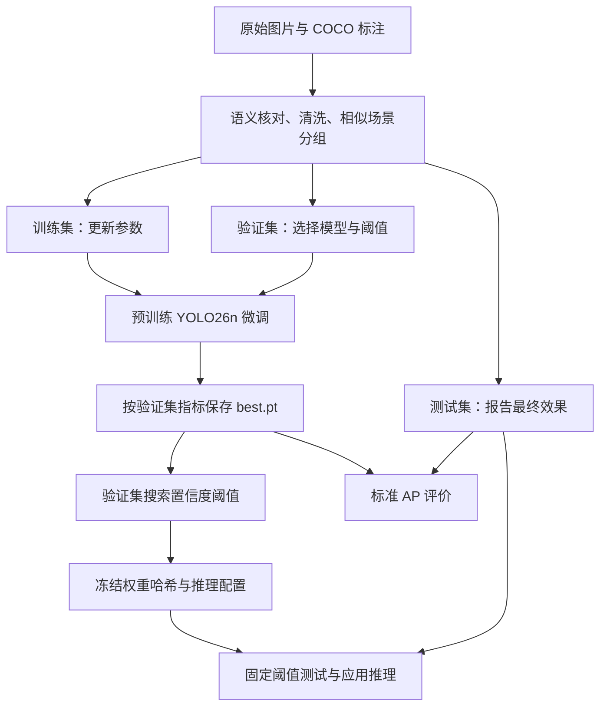
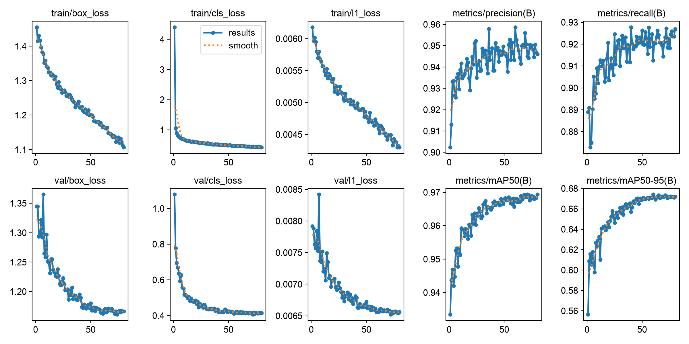

# YOLO 训练流程导读：以安全帽检测项目为例

本文面向有软件开发经验、希望通过一个实际项目了解 YOLO 训练流程的读者。阅读主线是：训练数据如何组织，一次训练怎样更新模型，怎样选择权重，以及如何把训练指标转成可用的检测配置。各阶段均对应仓库中的代码和实验产物。

项目使用 Ultralytics YOLO26n，在 Hard Hat Workers 数据集上微调，检测 `helmet` 与 `no_helmet`。训练和评价由框架执行，项目脚本负责数据治理、实验参数、状态记录、阈值选择与结果交付。理解流程可以直接阅读代码和已有结果，无需先重新训练。

## 1. 从哪里读起

建议按下面的顺序阅读：

| 阶段 | 代码或产物 | 重点 |
| --- | --- | --- |
| 数据准备 | [prepare_dataset.py](../scripts/prepare_dataset.py) | `audit → prepare → verify`，标签转换与分组划分 |
| 训练入口 | [train_helmet.py](../scripts/train_helmet.py) | 加载预训练权重、传入参数、注册训练回调 |
| 收敛过程 | [results.csv](../runs/helmet/yolo26n_100e_b8_20261015_145934/results.csv) | 每轮训练损失、验证损失和检测指标 |
| 标准评价 | [evaluate_helmet.py](../scripts/evaluate_helmet.py) | 对固定测试集计算 AP，保存评价口径 |
| 阈值确定 | [validate_monitor.py](../scripts/validate_monitor.py) | 验证集搜索、冻结配置、固定阈值测试 |
| 应用推理 | [monitor_helmet.py](../scripts/monitor_helmet.py) | 校验权重、调用预测、绘制和保存结果 |



图中有两条评价路径：标准 AP 衡量模型在多个置信度下的检测能力；固定阈值评价衡量应用实际使用某个阈值时的误报和漏报。后文会区分它们。

## 2. 先把业务问题变成训练样本

这里采用目标检测：一张图片可以对应多个目标，每个目标都有类别和边界框。模型既要判断类别，也要定位。

原始数据是 COCO 格式，包含 `helmet`、`head`、`person` 等类别。本项目保留两类：

| 原始类别 | 训练类别 | class ID |
| --- | --- | ---: |
| `helmet` | `helmet` | 0 |
| `head` | `no_helmet` | 1 |

`person` 和父类 `Workers` 不参与训练。`head → no_helmet` 的映射经过抽样语义核对；这一步决定了模型究竟在学习什么。它识别的是可见头部的安全帽状态，不提供完整的人员跟踪与身份关联。

### 标签如何转换

COCO 的框是像素坐标 `[x, y, width, height]`，其中 `x, y` 为左上角。YOLO 检测标签是一行一个目标：

```text
class_id center_x / image_width center_y / image_height width / image_width height / image_height
```

例如，640×480 图片中一个未戴帽目标的 COCO 框为 `[100, 50, 40, 20]`，转换后为：

```text
1 0.187500000 0.125000000 0.062500000 0.041666667
```

导出图片和标签按文件名一一配对：

```text
yolo/
  data.yaml
  images/train/example.jpg
  labels/train/example.txt
```

项目保留原图字节和尺寸，尺寸适配与归一化交给训练数据管线。`verify()` 会从源 COCO 标注独立计算预期坐标，逐一核对导出结果，避免把标签转换错误带入训练。

### 为什么重新划分数据

原始数据共 7035 张，抽查发现部分图片存在重复目标框、漏标或普通帽子语义不清等问题。项目排除 9 张，没有猜测补标，最终保留 7026 张。

划分前先检查像素重复，再联合 pHash、dHash 找相似候选，并补充人工场景归组。共识别 233 对相似候选，形成 6809 组；同一组整体进入一个集合，尽量避免相邻帧或同图变体同时出现在训练集和测试集。

| 集合 | 图片数 | 戴帽框 | 未戴帽框 | 用途 |
| --- | ---: | ---: | ---: | --- |
| train | 4916 | 13799 | 4677 | 计算梯度、更新参数 |
| val | 1406 | 3938 | 1334 | 选择权重、确定阈值 |
| test | 704 | 1973 | 666 | 报告最终检测效果 |

随机种子为 42，划分约为 70% / 20% / 10%。人工决定保存在 [manual_review.json](../datasets/hard-hat-workers/audit/manual_review.json)，最终对应关系保存在 [split_manifest.json](../datasets/hard-hat-workers/audit/split_manifest.json)。

原数据缺少可靠的拍摄批次和场景 ID，哈希分组只能控制已识别的相似样本。因此，测试结果代表当前划分上的表现，对新工地的泛化仍需要额外数据验证。具体方法见[预处理记录](../datasets/hard-hat-workers/PREPROCESSING.md)。

## 3. 训练入口做了什么

项目训练入口的核心可以概括为：

```python
model = YOLO("weights/yolo26n.pt")
model.train(
    data="datasets/hard-hat-workers/yolo/data.yaml",
    epochs=100,
    batch=8,
    imgsz=640,
    patience=20,
    seed=42,
)
```

以上是阅读用的核心调用；设备、输出目录、回调与完整参数以 [train_helmet.py](../scripts/train_helmet.py) 为准。

`YOLO(...)` 加载预训练模型。开始训练时，框架根据数据配置将检测类别适配为两类，并加载形状兼容的预训练参数。本次日志记录迁移了 `696/708` 个参数项，这是 state dict 项数，不是网络层数。随后进行全模型微调，未配置冻结 backbone。

预训练提供了已经学到的视觉特征。本项目通过带标注的安全帽图片继续更新参数，使模型适应目标类别和数据分布。两类模型在本次训练日志中的规模为约 250 万参数。

### 显式参数与实际生效参数

| 参数 | 本次设置 | 在流程中的作用 |
| --- | --- | --- |
| 模型 | YOLO26n 预训练权重 | 微调起点，`n` 为该系列的小规模版本 |
| `epochs` | 100 | 最多遍历训练集 100 轮 |
| `batch` | 8 | 每个训练 batch 的图片数 |
| `imgsz` | 640 | 模型输入尺度的配置值 |
| `patience` | 20 | 验证集 fitness 连续 20 轮未改进时停止 |
| `seed` | 42 | 控制随机过程，跨设备仍可能存在数值差异 |
| `device` | 原实验 MPS | 当前入口可自动选择 MPS / CUDA / CPU |
| `workers` | 2 | 数据加载并发配置，框架可能按设备调整 |

其余参数来自固定版本框架的默认配置。这里需要结合运行结果理解默认值，不能只看参数名称：

- `optimizer=auto`：原训练日志实际选择 **AdamW，初始学习率 0.001667，momentum 参数 0.9**。默认配置中的 `lr0=0.01` 被自动策略覆盖。
- `warmup_epochs=3`，`cos_lr=False`：先 warmup，再按线性学习率调度继续训练。
- `nbs=64`：框架进行梯度累积；warmup 后通常约每 8 个 batch 更新一次参数，不能把 `batch=8` 等同于每次优化只使用 8 张图片的梯度。
- 默认启用 Mosaic、水平翻转、HSV 和尺度/平移等在线增强。没有生成离线增强数据，验证与测试不使用随机训练增强。
- `close_mosaic=10` 对应计划训练的最后 10 轮；本次第 80 轮提前停止，没有进入原定的关闭窗口。
- 配置中的 `amp=True` 还需经过设备检查；该固定版本对 MPS 关闭 AMP，不能据此把本次训练描述为 CUDA FP16 训练。

这些细节对应的原训练日志摘录如下，完整日志未纳入 Git 仓库：

```text
Transferred 696/708 items from pretrained weights
optimizer: AdamW(lr=0.001667, momentum=0.9)
EarlyStopping: ... Best results observed at epoch 60 ...
```

框架固定在 Ultralytics `8.4.177`、提交 `00cd4b8b187b6c7bc34776a6fe25a000f08b5fcc`。自动优化器、损失和默认增强都应按这个版本理解。

## 4. 一次训练迭代如何更新模型

理解 `model.train()`，可以沿着下面的数据流看框架实现：

1. **构造 batch。** 读取图片和标签，应用训练增强与尺寸适配，将图片转为模型使用的张量，并将像素值除以 255。
2. **前向计算。** Backbone 提取特征，多尺度特征融合后，由检测头产生候选位置的类别分数和框预测。
3. **分配监督目标。** 使用预测与真实标注的分类和定位信息，为候选位置分配训练目标。训练时的这种目标分配，与评价时把预测框匹配到真实框，是两套用途不同的逻辑。
4. **计算损失并反向传播。** 分类和定位误差形成可求导的训练目标，通过 `backward()` 计算参数梯度。
5. **优化器更新。** 达到梯度累积条件后执行梯度裁剪、AdamW 更新、清空梯度，并更新 EMA 参数副本。
6. **每轮验证。** 在验证集上计算检测指标，记录 CSV，决定是否更新 `best.pt`，以及是否提前结束。

本项目没有重写这些训练步骤。要继续追踪，优先阅读固定提交中的 [DetectionTrainer](https://github.com/ultralytics/ultralytics/blob/00cd4b8b187b6c7bc34776a6fe25a000f08b5fcc/ultralytics/models/yolo/detect/train.py)、[BaseTrainer](https://github.com/ultralytics/ultralytics/blob/00cd4b8b187b6c7bc34776a6fe25a000f08b5fcc/ultralytics/engine/trainer.py) 和[损失实现](https://github.com/ultralytics/ultralytics/blob/00cd4b8b187b6c7bc34776a6fe25a000f08b5fcc/ultralytics/utils/loss.py)。

### 本项目使用的 YOLO26 有哪些实现细节

[模型配置](https://github.com/ultralytics/ultralytics/blob/00cd4b8b187b6c7bc34776a6fe25a000f08b5fcc/ultralytics/cfg/models/26/yolo26.yaml)使用 P3/8、P4/16、P5/32 三个输出尺度，配置为 `end2end=True`、`reg_max=1`。

训练包含 one-to-many 和 one-to-one 两个分支，`E2ELoss` 按随训练变化的权重组合两者损失。one-to-one 分支在训练时使用 detach 后的特征；应用推理默认使用 one-to-one 分支输出，并走端到端后处理。

本次 CSV 中的三项损失为：

| 字段 | 对应内容 |
| --- | --- |
| `box_loss` | 基于 CIoU 的框回归损失 |
| `cls_loss` | 类别预测的 BCE 损失 |
| `l1_loss` | `reg_max=1` 时使用的归一化框距离 L1 损失 |

配置仍沿用 `dfl` 作为第三项增益的参数名，但该模型走的是 L1 分支。`E2ELoss` 用于记录的分项来自 one-to-one 分支，CSV 中的三列不能直接还原双分支加权后的总训练目标。阅读其他 YOLO 版本的教程时，需要核对这些差异。

## 5. 怎样判断训练结束，以及选哪份权重

本次计划 100 轮，实际完成 80 轮，耗时约 3 小时 56 分钟。以下数据来自 [results.csv](../runs/helmet/yolo26n_100e_b8_20261015_145934/results.csv)：

| Epoch | train box loss | val box loss | val mAP50 | val mAP50–95 |
| --- | ---: | ---: | ---: | ---: |
| 1 | 1.45489 | 1.34460 | 93.34% | 55.64% |
| 20 | 1.27910 | 1.23817 | 95.70% | 64.20% |
| 60 | 1.17052 | 1.16340 | 96.78% | 67.41% |
| 80 | 1.10670 | 1.16617 | 96.94% | 67.19% |



固定版本的检测 fitness 使用验证集 **mAP50–95**。第 60 轮取得最佳值，之后 20 轮没有超过它，触发 `patience=20`。所以本次使用第 60 轮对应的 `best.pt`。第 80 轮训练损失更低、mAP50 略高，也不会改变按 mAP50–95 选模型的规则。

`last.pt` 表示最后状态，与最佳验证表现的权重用途不同。框架维护 EMA，并以 EMA 参数参与验证和检查点保存；项目最终只发布了用于评价与演示的 `best.pt`。

曲线显示后期训练损失继续下降，而验证指标进入平台期。它支持“继续相同训练的收益有限”这一判断；当前结果不足以直接证明严重过拟合，也不能证明对新工地一定泛化良好。

## 6. 训练完成后，还有两件不同的评价工作

### 标准 AP：模型整体检测能力

[evaluate_helmet.py](../scripts/evaluate_helmet.py)加载固定的 `best.pt`，在测试集上以较低候选阈值 `conf=0.001` 收集预测，计算 Precision–Recall 曲线和 AP。

AP50 在 IoU≥0.50 的匹配要求下计算 AP；AP50–95 再对 0.50～0.95、步长 0.05 的匹配阈值取平均，因此对框的位置精度要求更高。

| 类别 | AP50 | AP50–95 |
| --- | ---: | ---: |
| helmet | 98.05% | 66.96% |
| no_helmet | 94.97% | 67.34% |
| 两类平均 | 96.51% | 67.15% |

数值见 [metrics.json](../runs/evaluation/yolo26n_100e_b8_20261015_145934_test_metrics/metrics.json)。AP50 与 AP50–95 的差距说明严格定位仍有改进空间；小目标和标注范围差异可能相关，尚无消融实验证明其各自贡献。

该文件中的 P/R 使用测试曲线最大平滑平均 F1 对应的统计点，置信度约为 0.34835。这是标准指标的汇报口径。

### 固定阈值：应用实际会报出什么

应用需要一个具体的置信度阈值。[validate_monitor.py](../scripts/validate_monitor.py)在验证集搜索 0.10～0.80、步长 0.05，最大化未戴帽类 F1；并列时依次优先 Precision、较高阈值，最终选出 **0.40**。

脚本先写入冻结配置，再读取测试集，使用相同阈值统计 TP、FP、FN。匹配要求为类别正确、IoU≥0.50，按预测置信度降序进行一对一贪心匹配。

| 类别 | TP | FP | FN | Precision | Recall |
| --- | ---: | ---: | ---: | ---: | ---: |
| helmet | 1877 | 106 | 96 | 94.65% | 95.13% |
| no_helmet | 594 | 48 | 72 | 92.52% | 89.19% |

这组结果对应演示实际使用的阈值，与上面的标准评价 P/R 统计点不同。测试集此前已用于标准 AP 汇报；整个过程中未依据测试结果重新训练或选择阈值。搜索记录及固定阈值结果见 [acceptance.json](../deliverables/acceptance.json)。

还需要区分三种容易混淆的量：置信度阈值决定保留哪些预测；评价匹配 IoU 决定预测位置是否算对；API 中的 `iou=0.7` 属于后处理参数。YOLO26 默认端到端输出不需要传统 NMS，不能把该参数解释为本次评价的匹配阈值。

## 7. 从模型到演示程序

[config/monitor.json](../config/monitor.json)把权重路径、SHA256、输入尺度、阈值等绑定在一起。[monitor_helmet.py](../scripts/monitor_helmet.py)加载时先验证权重哈希，再执行推理和结果绘制。这保证演示使用的模型与记录中的模型一致。

图片和视频验证了输入、提示、绘制与保存流程。视频没有逐帧真值标注，不能用演示观感替代测试集上的定量结果。程序按当前帧统计检测框，不做跨帧人员跟踪；未检出目标也不会自动被归类为未戴帽。

如果要评价新训练的模型，必须显式指定 `--weights`；检测程序则需另建匹配新权重的配置并重新验证阈值。当前阈值搜索脚本绑定原实验的权重路径，尚未提供 `--weights` 参数。

## 8. 复现入口与继续实验的边界

环境安装见[项目 README](../README.md#快速开始)，原始数据恢复见[数据说明](../datasets/hard-hat-workers/README.md#恢复数据与重新生成划分)。原始数据和生成的 YOLO 数据未纳入仓库。

数据就绪后，各阶段命令如下；运行名和结果文件均需使用新名称：

```bash
python scripts/prepare_dataset.py audit
python scripts/prepare_dataset.py prepare
python scripts/prepare_dataset.py verify

python scripts/train_helmet.py --run-name review_training
python scripts/evaluate_helmet.py --run-name review_test --weights runs/helmet/review_training/weights/best.pt
```

已有生成数据时跳过前三条，`prepare` 会拒绝覆盖已有 `yolo/`。训练入口当前暴露 `--run-name`、`--device`，其他显式参数在脚本的 `options` 中。

若要重新核验原实验模型的阈值搜索：

```bash
python scripts/validate_monitor.py --output outputs/review_acceptance.json --config-output outputs/review_monitor.json
```

继续研究时，优先把问题落到可比较的实验上：小目标漏检可比较输入尺度与裁剪策略；普通帽子误识别可补充边界样本与语义复标；新工地泛化可引入按场景独立留出的数据。每次固定划分与评价协议、记录变量变化，才能判断改进来自哪里。

本项目只完成一套正式训练配置，没有做模型规模、增强策略或输入尺度的系统消融。现有结果可以用于讨论一次完整的 YOLO 微调流程，后续方案仍需新的实验验证。更完整的结果与场景分析见[实验报告](../deliverables/工地安全帽佩戴检测实验报告.docx)。
